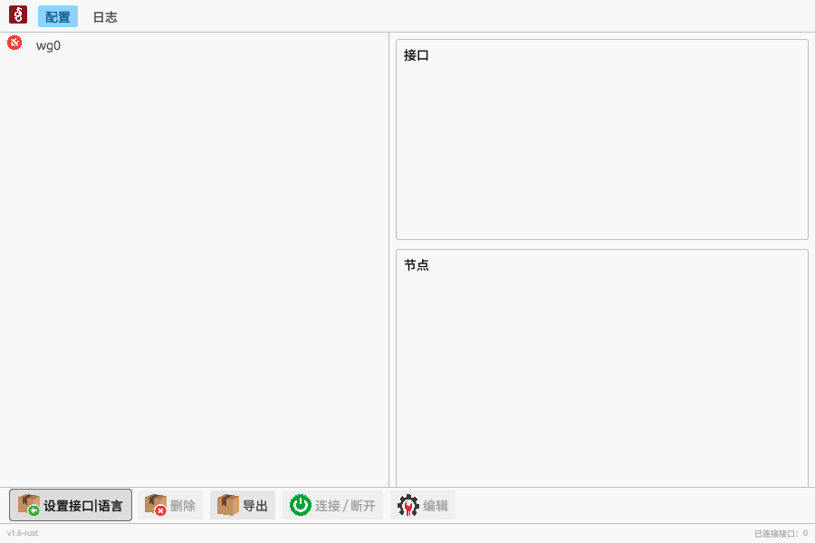
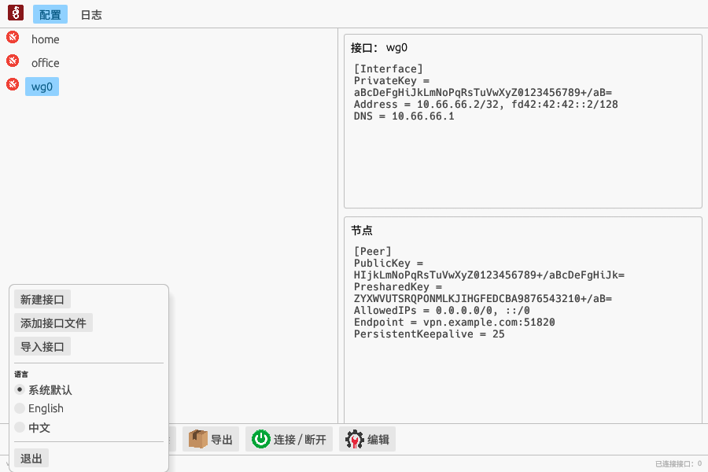

# wgp — WireGuard GUI (Rust 版)

WireGuard 的 Linux 桌面客户端，由 [wireguard-gui-python](https://github.com/gary113/wireguard-gui-python) 移植为 Rust。

界面、操作方式与 Python 版保持一致：读取 `/etc/wireguard` 下的 `*.conf`，通过 `wg-quick@<名称>.service` 连接/断开接口，界面支持中文/English 并可随时切换。



“设置接口|语言”菜单（新建/添加/导入接口，运行时切换语言）：



## 功能

- 列出 `/etc/wireguard` 中的所有接口（绿色/红色图标表示连接状态）
- 连接 / 断开接口（自动走 systemd，未用 systemd 管理时回退到 `wg-quick`）
- 新建接口、编辑配置（校验失败自动回滚到原配置）、重命名、删除
- 从 `.conf` 文件添加接口
- 导出全部接口为 zip / 从 zip 导入接口
- 实时显示 `journalctl -u 'wg-quick@*'` 日志（含最近 200 行历史）
- 系统托盘图标：点击显示主窗口，菜单中可直接切换每个接口，图标角标显示已连接数量
- 中英文界面，运行时切换并记忆（`~/.config/wireguard-gui-rust/wgp.ini`）
- 最小化/关闭到托盘继续运行

## 系统要求

- Linux + systemd（或可用的 `wg-quick`）
- `wireguard-tools`（提供 `wg` / `wg-quick`）
- `libdbus`（托盘图标使用 StatusNotifierItem 协议，各桌面环境均支持）
- Rust 工具链（仅构建需要）
- 中文字体（如 `fonts-noto-cjk` 或思源黑体），否则中文界面无法正常显示

## 构建与运行

```bash
cargo build --release
sudo ./target/release/wgp
```

或使用启动脚本（通过 pkexec 提权）：

```bash
./run.sh
```

wgp 需要管理 `/etc/wireguard` 和 `wg-quick` 服务，因此必须以 root 运行。

## 安装到系统

```bash
sudo ./install.sh
```

安装脚本会：

1. `cargo build --release` 构建二进制；
2. 安装 `/usr/local/bin/wgp` 与启动器 `/usr/local/bin/wgp-run`；
3. 安装图标与 `wgp.desktop`（应用菜单出现 wgp 图标）。

## 项目结构（与 Python 版的对应关系）

| Python 版 | Rust 版 | 说明 |
| --- | --- | --- |
| `wgp.py` | `src/main.rs` | 入口、root 检查 |
| `views/main.py` | `src/app.rs` | 主窗口、托盘交互、工具栏、标签页 |
| `views/new.py` / `views/edit.py` | `src/dialogs.rs` | 新建/编辑接口对话框（含公钥实时推导） |
| `utility/functions.py` | `src/wg.rs` | 接口的增删改、启停、导入导出 |
| `wgconfig` 库 | `src/config.rs` | 配置解析、拆分与校验 |
| `utility/language.py` | `src/i18n.rs` | 多语言（编译期字符串表，无需 .qm 文件） |
| QSettings | `src/settings.rs` | 轻量 INI 读写 |
| `utility/log_thread.py` | `src/log_watcher.rs` | journalctl 日志线程 |
| `resources/*.ui` | — | 界面直接用 Rust 构建（egui） |

技术栈：`eframe`/`egui`（GUI）、`ksni`（托盘图标）、`zip`（导入导出）、`image`（图标渲染）。

## 与 Python 版的差异

- **托盘图标**：Qt 的 `QSystemTrayIcon` 换成了 StatusNotifierItem（`ksni`），这是现代 Linux 桌面的托盘协议；
- **文件选择**：内置了一个简单的文件/目录选择对话框，不依赖 zenity 或 xdg-desktop-portal；
- **日志**：启动时先读取最近 200 行日志，不必等新日志产生；
- **翻译**：不再使用 Qt 的 `.ts/.qm` 文件，界面字符串直接写在 `src/i18n.rs` 的对照表中，新增语言只需加一列；
- **配置文件路径**：语言偏好保存在 `~/.config/wireguard-gui-rust/wgp.ini`（Python 版在 `~/.config/wireguard-gui-python/wgp.ini`），WireGuard 配置文件的位置不变。

## 开发

```bash
cargo test            # 单元测试（配置解析、字段读取、翻译完整性等）
cargo clippy          # 静态检查
WGP_CONFIGS_DIR=... ./target/debug/wgp   # 用其它目录代替 /etc/wireguard 做测试
```

## 许可

本项目沿用 GNU General Public License v3.0，见 [LICENSE](../LICENSE)。
